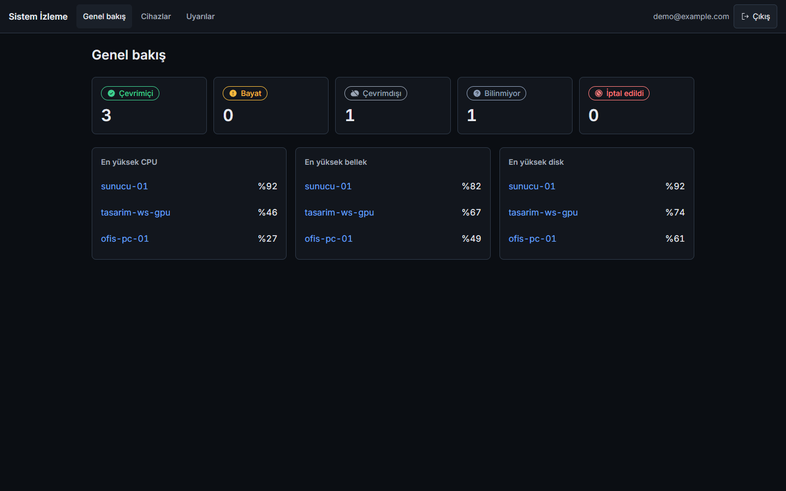
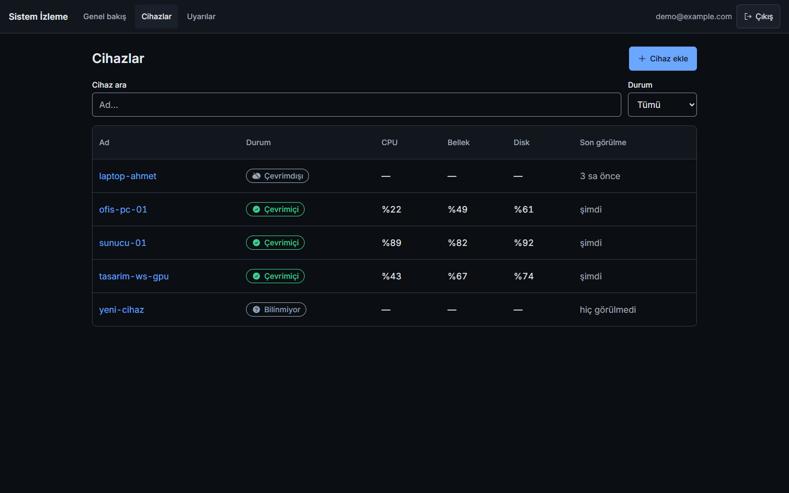
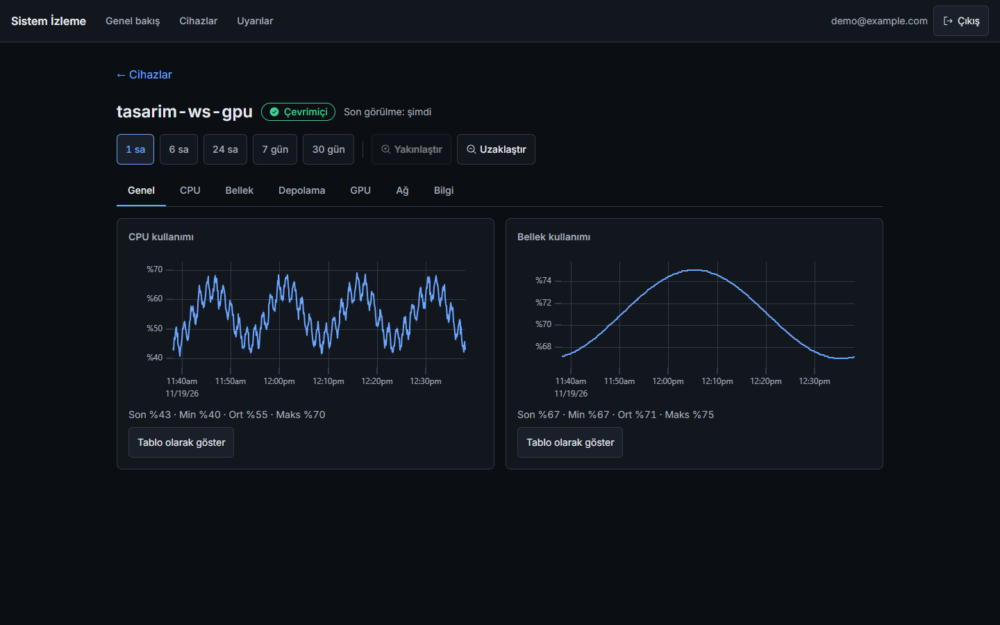
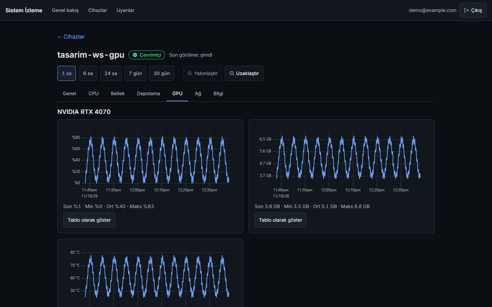
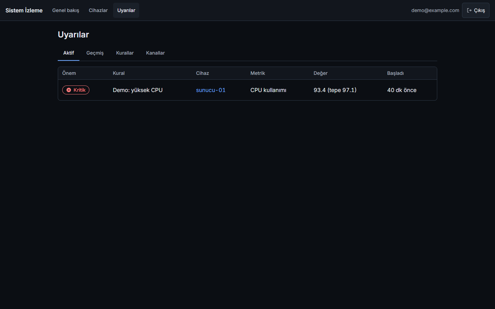
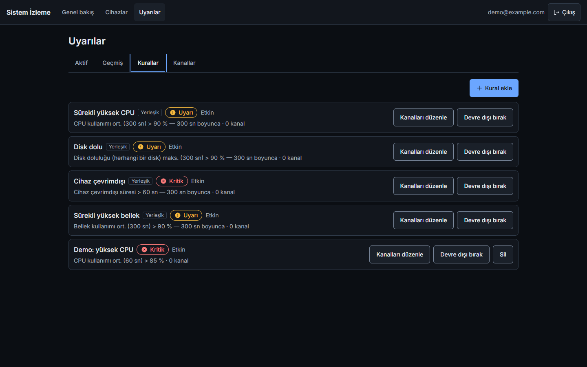
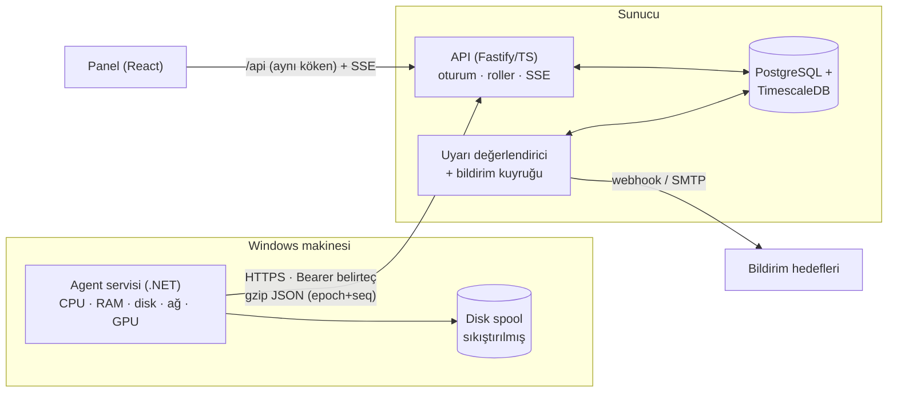

# Sistem İzleme Platformu

**Windows makinelerinin CPU, bellek, disk, ağ ve GPU verilerini toplayan, kendi sunucunuzda barındırabileceğiniz, açık kaynak izleme platformu.** Hafif bir .NET servisi (agent) ölçümleri güvenli biçimde bir TypeScript API'ye gönderir; veriler TimescaleDB'de tutulur; React paneli canlı grafikler, uyarılar ve bildirimler sunar.

[](https://github.com/emiranskr/system-monitoring-platform/actions/workflows/ci.yml)


> **English summary.** A self-hosted, open-source monitoring platform for Windows machines: a low-privilege .NET Windows-service **agent** (CPU / RAM / disk / network / NVIDIA GPU) → **Fastify + TypeScript API** (multi-tenant, session auth with Argon2id, replay-safe ingest, credential rotation) → **PostgreSQL + TimescaleDB** (hypertables, continuous aggregates, compression) → **React dashboard** (live SSE charts, alert rules, webhook/SMTP notifications). Security-first design (SSRF guard, AES-256-GCM secrets with AAD, strict CSP, tenant isolation), 1 000+ automated tests including real-browser end-to-end runs. Documentation is in Turkish. See [Status and limitations](#durum-ve-bilinen-sınırlar) for what is *not* verified yet (installer, real hardware sensors, real SMTP).

---

## Ekran görüntüleri

| Genel bakış | Cihazlar |
|---|---|
|  |  |
| **Cihaz detayı (CPU / bellek, canlı)** | **GPU sekmesi (kullanım, VRAM, sıcaklık)** |
|  |  |
| **Aktif uyarılar** | **Uyarı kuralları** |
|  |  |

> Görüntüler `pnpm demo:live` ile üretilen **sentetik** demo verisindendir (gerçek donanım ölçümü değildir). Yeniden üretmek için: [`scripts/demo-screenshots.mjs`](scripts/demo-screenshots.mjs).

## Özellikler

**Agent (Windows servisi, .NET 10)**
- CPU, bellek, disk, ağ ve NVIDIA GPU (NVML) ölçümleri; düşük yetkili sanal hesapta (`NT SERVICE\…`) çalışır, `LocalSystem` kullanmaz.
- Diske yazılan, sıkıştırılmış **spool**: ağ/sunucu kesintisinde veri kaybolmaz; sıra numaralı (`spool_epoch` + `seq`) tekrar gönderim güvenle yinelenebilir.
- **Kayıt (`--enroll`)**: panelden üretilen tek kullanımlık belirteçle sunucuya kaydolur; cihaz bilgisini (ad, OS, **GPU/ağ/disk listesi**) gönderir, kimlik bilgisini DPAPI ile korumalı depoya yazar. **Kimlik bilgisi döndürme (`--rotate`)** ve sunucu tarafında çalınmış kimlik bilgisi tespiti vardır. Gerçek API'ye karşı uçtan uca denendi ([ayrıntı](docs/kurulum-agent.md#kayıt-enrollment-ve-kimlik-bilgisi-döndürme--komut-satırı)); periyodik otomatik döndürme yoktur.
- **NVIDIA GPU (NVML):** kullanım, VRAM ve sıcaklık geliştirme makinesinde (RTX 5070) `nvidia-smi` ile çapraz doğrulandı; güç/fan/saat hızı sürücü destekliyorsa okunur ancak gerçek donanımda çapraz doğrulanmadı.
- Release derlemesi yalnızca HTTPS kabul eder (isteğe bağlı SPKI sertifika sabitleme).

**API (Fastify 5 + TypeScript)**
- Çok kiracılı (organizasyon bazlı) veri izolasyonu; roller: `owner` / `admin` / `viewer`.
- Oturum tabanlı kimlik doğrulama (Argon2id parola, `__Host-` çerezi, CSRF Origin denetimi, hız sınırları).
- Zod şemalarından üretilen **OpenAPI sözleşmesi** (`docs/api/openapi.json`) ve sözleşme testleri.
- Canlı veri için **SSE** akışı; sunucu tarafı örnek indirgeme (`max_points`) ve ham/1 dk katman seçimi.

**Veritabanı (PostgreSQL 16 + TimescaleDB 2.17)**
- Hypertable + continuous aggregate (`metric_1m`) + sıkıştırma politikaları; sürümlü SQL migration'ları.
- Otomatik **yedek/geri yükleme tatbikatı** (`pnpm drill:backup`).

**Panel (React 19 + Vite + Tailwind v4)**
- Genel bakış, cihaz listesi, cihaz detayı (CPU, bellek, depolama, ağ, GPU), zaman aralığı seçimi ve yakınlaştırma, canlı güncelleme (SSE).
- Grafikler uPlot ile; her grafik için erişilebilir **tablo görünümü**; WCAG odaklı (axe testleri), koyu tema.

**Uyarılar ve bildirimler**
- Kurallar: metrik, toplama (ort/maks), pencere, operatör, eşik, histerezis, süre; durum makinesi OK → PENDING → FIRING → RESOLVED.
- Yerleşik kurallar: cihaz çevrimdışı, disk dolu, sürekli yüksek CPU/bellek.
- Kanallar: **webhook** (zaman damgalı HMAC imza) ve **e-posta (SMTP)**; kalıcı bildirim kuyruğu, tekilleştirme, üstel geri çekilme.

## Mimari



Ayrıntılı kararlar: [`docs/proposal.md`](docs/proposal.md) ve [`docs/adr/`](docs/adr/).

## Teknoloji yığını

| Katman | Teknoloji |
|---|---|
| Agent | .NET 10 (Worker Service), xUnit, PDH/NVML |
| API | Node ≥ 22, Fastify 5, Zod 4, `pg`, Vitest |
| Veritabanı | PostgreSQL 16, TimescaleDB 2.17 (Docker) |
| Panel | React 19, Vite 8, Tailwind v4, Radix UI, TanStack Query, uPlot |
| Test | Vitest, xUnit, Playwright (gerçek Chrome) + axe |
| Dağıtım | nginx örneği, GitHub Actions CI, Inno Setup betiği (agent) |

## Hızlı başlangıç (yerel demo)

Önkoşullar: Node ≥ 22, pnpm, Docker Desktop, (agent için) .NET 10 SDK.

```bash
pnpm install
cp deploy/.env.example deploy/.env           # yerel geliştirme parolasını gerekirse değiştirin
docker compose -f deploy/docker-compose.yml --env-file deploy/.env up -d --wait
pnpm build

# API (ortam değişkenleri: docs/web-kurulum.md §1)
node apps/api/dist/server.js
# başka terminalde: panel
pnpm --filter @sysmon/web dev                # http://localhost:5173

# başka terminalde: demo verisi + canlı akış (parola çıktıda yazar)
pnpm demo:live
```

Demo giriş e-postası `demo@example.com`; **parola her çalıştırmada rastgele üretilip yalnızca çıktıda gösterilir.** Ayrıntı: [`docs/demo.md`](docs/demo.md), [`docs/web-kurulum.md`](docs/web-kurulum.md).

## Güvenlik tasarımı

- **Tenant izolasyonu:** her sorgu `org_id` ile sınırlı; bileşik yabancı anahtarlar çapraz-organizasyon bağlantıyı yapısal olarak engeller; IDOR testleri tüm rotaları otomatik tarar.
- **Webhook/SMTP için SSRF koruması:** özel/loopback/link-local/bulut-metadata aralıkları (IPv4 + IPv6, NAT64/6to4 dahil) engellenir; DNS çözümlenen adrese **sabitlenerek** bağlanılır (DNS rebinding yok), yönlendirme izlenmez, HTTPS ve TLS doğrulaması zorunlu.
- **Sırlar:** kanal sırları **AES-256-GCM** ile (her şifrelemede yeni nonce, **AAD = organizasyon + kanal**) saklanır; API'ye hiçbir zaman geri dönmez.
- **Replay-güvenli veri girişi** ve belirteç döndürmede yeniden kullanım tespiti; webhook imzası zaman damgalıdır (±300 sn tolerans).
- **Sıkı CSP** (`unsafe-eval`/satır içi betik yok), HSTS ve diğer başlıklar — derlenmiş panel gerçek tarayıcıda CSP altında test edilir.
- **Üretimde dev bayrakları reddedilir:** `NODE_ENV=production` iken SSRF korumasını kapatan bayraklarla API başlamaz.
- Güvenlik açığı bildirimi: [`SECURITY.md`](SECURITY.md).

## Test ve kalite

- **1 000+ otomatik test:** API (468), panel (217), protokol (73), veritabanı (27), betik (24), agent (.NET Debug 405 / Release 390) ve **gerçek tarayıcıyla uçtan uca (Playwright, 120 test)** — geçici bir TimescaleDB, derlenmiş API ve Chrome ile.
- `pnpm test:security`: tek komutla güvenlik kapısı (çapraz-organizasyon, replay, rotation, oturum, SSRF, sırlar, kuyruk).
- Geliştirme sürecinde **bağımsız kod incelemeleri** (Critical 0 / Important 0 kabul ölçütü), mutasyon kontrolleri ve "önce kırmızı" test disiplini; ilerleme ve bulgular [`docs/ilerleme/`](docs/ilerleme/) altında.
- Lisans taraması: `pnpm license-scan` (izinsiz lisans yok).

## Proje yapısı

```
agent/windows/   .NET agent, sensör yardımcısı, kurulum betikleri (Inno + PowerShell)
apps/api/        Fastify API, uyarı değerlendirici, bildirim kuyruğu
apps/web/        React paneli + Playwright E2E
packages/        protocol (Zod + OpenAPI), db (migration'lar), fake-agent
deploy/          docker-compose (geliştirme), nginx/env örnekleri, güvenlik başlıkları
scripts/         demo, yedek tatbikatı, lisans taraması
docs/            mimari, ADR'ler, kılavuzlar, ilerleme kayıtları
```

## Durum ve bilinen sınırlar

Bu depo **yerel geliştirme ve gösterim için tamamdır**; aşağıdakiler **henüz doğrulanmadı** ve tamamlanmış gibi sunulmaz:

- **Kurulum paketi (Inno Setup):** betik yazıldı ve statik olarak sınandı, ancak **derlenmedi / gerçek Windows'ta kur-yükselt-kaldır testi yapılmadı**; Defender/SmartScreen davranışı ölçülmedi (yönetici yetkisi gerektirir). Bkz. [`docs/kurulum-agent.md`](docs/kurulum-agent.md).
- **Windows servis doğrulaması** ve resmî 30 dakikalık dayanıklılık koşusu bu depodaki otomasyonla yapılmaz.
- **CPU/anakart sıcaklığı ve ek sensörler:** LibreHardwareMonitor/PawnIO entegrasyonu **yapılmadı**. Sensör yardımcı süreci (korumalı pipe, Job Object, watchdog) ve servise bağlama (`--sensor-helper`, **varsayılan kapalı**, güvenli-kapalı) hazırdır, ancak üretim yardımcısı yalnız `NullSensorProvider` kullanır ("kullanılamıyor"). NVIDIA GPU sıcaklığı bundan bağımsız olarak NVML ile çalışır.
- **E-posta (SMTP)** yalnızca sahte SMTP sunucusuyla sınandı; gerçek sunucu denenmedi.
- **Üretim dağıtımı** (TLS/nginx, gerçek alan adı) örnek yapılandırma olarak sunulur; gerçek ortamda denenmedi.
- Tek API örneği desteklenir (zamanlanmış işler süreç içi); `CHANNEL_KEY`/`CREDENTIAL_KEY` döndürme yoktur ([`docs/yedekleme.md`](docs/yedekleme.md)).

## Belgeler

[Mimari öneri](docs/proposal.md) · [ADR'ler](docs/adr/) · [Web kurulumu](docs/web-kurulum.md) · [Uyarılar](docs/uyarilar.md) · [Üretim dağıtımı](docs/uretim-dagitim.md) · [Yedekleme](docs/yedekleme.md) · [Agent kurulumu](docs/kurulum-agent.md) · [Demo](docs/demo.md) · [Lisanslar](docs/licenses.md) · [İlerleme kayıtları](docs/ilerleme/)

## Katkı ve lisans

Katkı rehberi: [`CONTRIBUTING.md`](CONTRIBUTING.md). Lisans: **Apache-2.0** ([`LICENSE`](LICENSE)); bağımlılık lisansları [`docs/licenses.md`](docs/licenses.md) içindedir.
