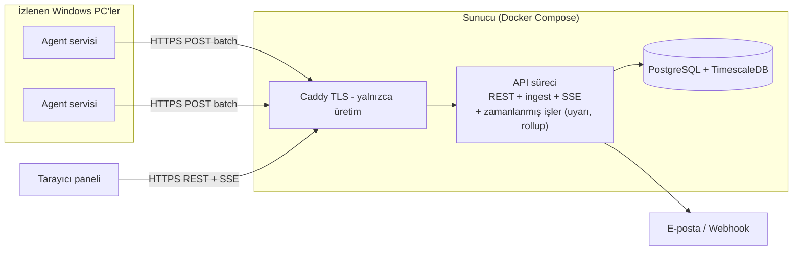
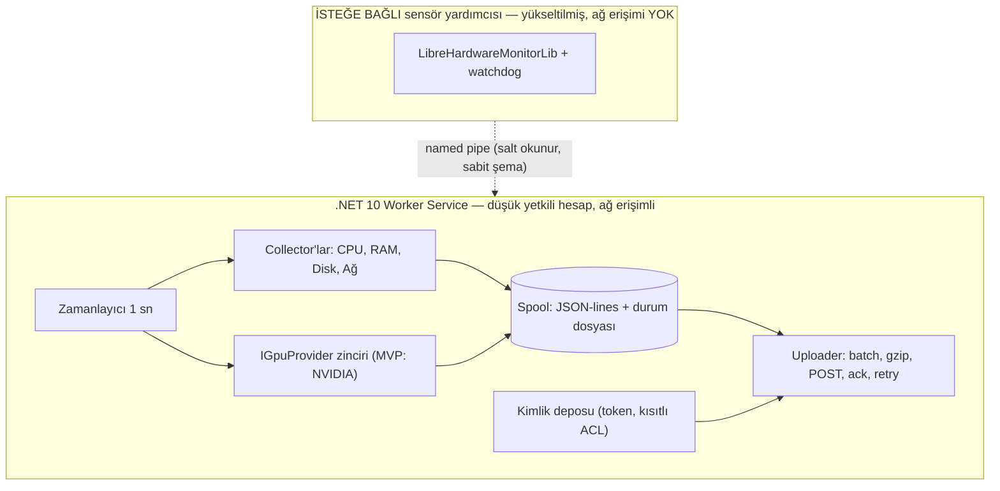
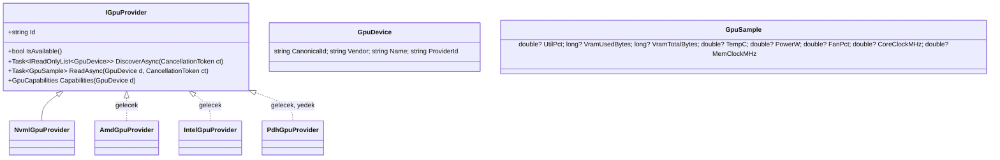
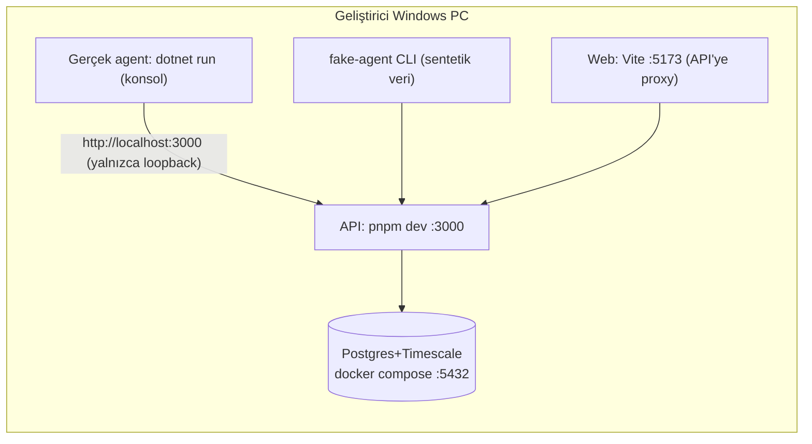

# Sistem İzleme Platformu — Teknik Öneri (Revizyon 3)

Durum: TASLAK, onay bekliyor. Yalnızca planlama aşaması; hiçbir uygulama kodu yazılmadı, hiçbir bağımlılık kurulmadı.
Tarih: 2026-11-11
Eşlik eden belge: [Uygulama planı](superpowers/plans/2026-11-11-system-monitoring-platform.md)

## 0. Revizyon geçmişi ve kanıt düzeyleri

| Sürüm | Değişiklik |
|---|---|
| Rev 1 | İlk öneri. |
| Rev 2 | .NET 10, GPU soyutlama katmanı, LHM/NVML değerlendirmesi, sadeleştirme, kapasite "doğrulanmamış hedef", güvenlik modeli, yerel geliştirme, lisans. |
| Rev 2.1 | Birinci bağımsız inceleme düzeltmeleri (RLS kapsamı, sayısal bütçeler, rotation idempotency, saat sapması, düşük yetkili agent). |
| **Rev 3** | Kullanıcının başlangıç varsayımları D1–D11 işlendi (D3 hariç, o onay bekliyor); ikinci bağımsız inceleme (N1–N13) düzeltmeleri; belge Türkçeye çevrildi. |

**Kanıt etiketleri** (önceki "verified" etiketi yanıltıcı bulundu, değiştirildi):

- **[Okundu]** — ilgili sayfa bu oturumda doğrudan açılıp okundu (yalnızca LibreHardwareMonitor README'si ve PawnIO deposu sayfası).
- **[Özet]** — web arama sonucu özetinde geçiyor; kaynak sayfa doğrudan okunmadı.
- **[Tek kaynak]** — yalnızca tek ikincil kaynak bildiriyor.
- **[Ön bilgi]** — yazarın genel bilgisi; bu oturumda kaynağa bakılmadı.

Hiçbir madde elle (donanım üzerinde) test edilmedi. [Özet], [Tek kaynak] ve [Ön bilgi] maddeleri, ilgili spike veya M0 lisans taramasında doğrulanana kadar "doğrulanmamış" sayılır (bkz. §21).

## 1. Ürün vizyonu ve çekirdek özellikler

Windows makinelerinin (CPU, RAM, GPU, disk, ağ, sıcaklık) canlı ve geçmiş sağlığını tek bir web panelinde gösteren, kendi sunucunuzda barındırılabilir, hafif bir platform; sorunlar kesintiye dönüşmeden uyarı verir.

Çekirdek: Windows agent servisi; canlı panel ve geçmiş grafikler; çoklu cihaz ve etiketler; eşik uyarıları (e-posta, webhook); çevrimdışı tespiti; kullanıcı hesapları ve roller; güvenli cihaz kaydı (enrollment).

İlkeler: agent yükü hedefi CPU < %1, RAM < 50 MB (hedef; M1'de ölçülür); agent yalnızca dışarı doğru bağlanır; tek komutla kurulum; her özellik işletim maliyetini hak etmeli.

## 2. MVP kapsamı ve gelecek özellikler

**MVP:** CPU, RAM, disk kullanımı ve I/O, ağ, NVIDIA GPU, isteğe bağlı sıcaklık için agent; enrollment token akışı; tek organizasyon, `owner/admin/viewer` rolleri; canlı görünüm ve geçmiş (1s/24s/7g/30g); e-posta ve webhook uyarıları; çevrimdışı uyarısı; Docker Compose sunucu; Inno Setup ile agent kurulumu.

**Sonra:** AMD/Intel GPU sağlayıcıları; süreç bazlı top-N; servis/olay günlüğü; S.M.A.R.T.; Linux/macOS agent; çoklu organizasyon ve SSO; TOTP 2FA; istek imzalama; agent otomatik güncelleme; Telegram/Discord; Prometheus dışa aktarımı.

**Kapsam dışı (anti-hedefler):** agent'a uzaktan komut çalıştırma veya uzaktan kontrol; agent tarafında gelen bağlantı dinleyicisi; SaaS faturalama.

## 3. Teknoloji seçimleri

### 3.1 .NET 10 LTS destek kontrolü

- Microsoft destek politikası: .NET 10 LTS, ilk sürüm 2025-11-11, **destek sonu 2028-11-14** **[Özet]** (arama özeti; politika sayfası doğrudan okunmadı, M0'da yeniden kontrol edilir). Kaynak: [.NET destek politikası](https://dotnet.microsoft.com/platform/support/policy/dotnet-core).
- Aynı kaynaklar .NET 8 ve .NET 9 desteğinin **2026-11-10** tarihinde bittiğini bildiriyor **[Özet]**; dolayısıyla .NET 8 geçerli bir seçim değil. Bir üçüncü taraf rehber .NET 10 için 2028-11-10 yazıyor; Microsoft tarihi esas alınır.
- LibreHardwareMonitorLib README'si .NET 8, 9 ve 10 hedeflerini listeliyor **[Okundu]**.
- Eylem: M0'da politika sayfası doğrudan okunur, SDK `global.json` ile sabitlenir. **Karar D1: .NET 10 LTS (onaylandı, başlangıç varsayımı).**

### 3.2 Yığın

| Katman | Seçim | Alternatifler | Not |
|---|---|---|---|
| Agent | .NET 10 Worker Service (Windows Service), PDH, NVML (P/Invoke), LibreHardwareMonitorLib (yalnızca isteğe bağlı sensör yardımcısında) | Rust | Sıcaklık için Rust da LHM benzeri bileşen gerektirir. |
| Backend | TypeScript, Fastify, Node LTS | Go, ASP.NET Core | **D2: TypeScript + Fastify (onaylandı).** |
| Veritabanı | PostgreSQL 16+ ve TimescaleDB (sürüm sabitlenir) | Düz Postgres + bölümleme; ClickHouse | Lisans için §15, kapasite için §8.3. |
| Ingest | HTTPS POST, gzip JSON batch | WebSocket, gRPC | Durumsuz, basit auth ve replay yönetimi. |
| Panele canlı akış | Server-Sent Events | WebSocket | Tek yönlü akış yeterli. |
| Frontend | React, Vite, TypeScript, TanStack Query, Tailwind, shadcn/ui, uPlot | Next.js, ECharts | Giriş arkasında SPA. |
| Ters vekil | Caddy (yalnızca üretim) | Nginx | Otomatik TLS. |
| Kurulum paketi | **Inno Setup (ilk sürüm için değerlendirilecek, D8)** | WiX, MSIX | Lisans notları §15'te. |
| Monorepo | pnpm workspaces; yanında .NET solution | Turborepo, Nx | Turborepo ertelendi. |

## 4. Sistem mimarisi

### 4.1 Genel bakış



Üretimde üç bileşen: Caddy, API, Postgres. Yerelde iki: API (ana makinede) ve Postgres (konteynerde).

### 4.2 Karmaşıklık ve işletme maliyeti incelemesi

| Rev 1 öğesi | Karar | Gerekçe |
|---|---|---|
| Redis | **Çıkarıldı** | Çok örnekli fan-out gerekmedikçe lazım değil; Redis lisans karmaşası da yok. Gerekirse Valkey. |
| Ayrı worker süreci | **Ertelendi** | İşler API içinde zamanlanır; advisory lock ile ikinci örnek çift çalışmaz. |
| Agent WebSocket | **HTTPS POST ile değiştirildi** | Durumsuz, yeniden deneme basit, idempotent. Config, ingest yanıtıyla gelir. |
| Panel WebSocket | **SSE** | Tek yönlü. |
| JWT çifti | **Sunucu tarafı oturum çerezi** | İptal edilebilir, JS'te token yok. |
| mTLS, TOTP, MessagePack, Telegram/Discord, Turborepo, Storybook | **Ertelendi** | MVP'yi kanıtlamak için gerekmiyor. |
| Rollup katmanları | **Ham + 1 dk** (D7); 15 dk katmanı benchmark sonucuna göre | Bkz. §8. |
| Agent tamponu | **JSON-lines spool** (varsayılan) | Yerel SQLite paketleme sorunu yok; M1 gerektirirse SQLite. |

İşletme maliyeti tahmini (**[Ön bilgi]**, M2 sonuçlarıyla değiştirilecek): küçük kurulum için ~2 vCPU / 4 GB RAM bir VPS ve alan adı. Kod imzalama sertifikası şimdilik yok (D6).

## 5. Windows agent mimarisi ve yetkiler



- **Servis modeli:** Windows Service, otomatik başlatma, çökme kurtarma. Geliştirmede konsol modu (`dotnet run`).
- **Yetki ilkesi (D4):** Ağa bakan agent **düşük yetkili servis hesabında** çalışır. Yönetici yetkisi gerektiren sürücü ve yardımcı bileşenler **isteğe bağlıdır ve varsayılan kapalıdır**. Sıcaklık yoksa panelde "kullanılamıyor" görünür.
- **Düşük yetkili hesabın fizibilitesi (doğrulanmamış, G0 spike'ında test edilecek) [Ön bilgi]:**
  - PDH sayaçları için hesabın "Performance Monitor Users" grubunda olması gerekebilir; installer ekler.
  - `root\cimv2` Win32_* sınıfları genelde okunur; `root\wmi`, Storage (SMART, MSFT_PhysicalDisk) ve disk IOCTL (`\\.\PhysicalDrive`) büyük olasılıkla yönetici ister → **bunlar yardımcıya taşınır**.
  - NVML'in standart kullanıcı/servis hesabında çalışması beklenir.
  - Bozuk performans sayaçları (`lodctr`) için yedek davranış: ilgili collector "kullanılamıyor" der.
  - G0 spike'ı "standart hesapla hangi alan dolu" matrisini üretir.
- **Sensör yardımcısı güvenliği:**
  - Named pipe: `PIPE_REJECT_REMOTE_CLIENTS`, `FILE_FLAG_FIRST_PIPE_INSTANCE` (squatting'e karşı), ACL yalnızca agent hesabına.
  - Protokol salt okunur, sabit şemalı, boyut sınırlı: ele geçirilmiş bir agent yardımcı üzerinden çekirdek sürücüye komut gönderemez.
  - Yardımcı ikili dosyası yazılamaz dizinde; minimum ayrıcalık; ağ erişimi yok (güvenlik duvarı kuralı).
  - LHM takılırsa süreç içinde iptal edilemez → **yardımcı süreci öldürüp yeniden başlatan watchdog**.
  - Diğer donanım izleme araçlarıyla (örn. HWiNFO) SMBus/mutex çakışması olasılığı spike'ta ölçülür **[Ön bilgi]**.
- **Spool:** JSON-lines segmentleri + ayrı, atomik yazılan durum dosyası (`spool_epoch`, `next_seq`, saat ofseti). Sınırlar: 24 saat **ve** 50 MB, hangisi önce dolarsa; en eski segment atılır ve atılan sayı loglanır. Yarım yazılmış son satır açılışta atlanır. 30 metrik / 5 sn'de 24 saatlik ham hacim ~520 bin değer; 50 MB'ı aşabilir → M1 ölçer, sınırlar buna göre ayarlanır.
- **Zaman:** Örnek zaman damgaları için monotonic saat + sunucudan öğrenilen ofset kullanılır (NTP atlamalarına dayanıklı).
- Her collector zaman aşımı ve hata izolasyonu ile çalışır; hata `collector_status` kaydıdır, çökme değil.

## 6. Veri toplama

### 6.1 Yöntemler

| Metrik | Yöntem | Güven / kanıt |
|---|---|---|
| CPU | PDH `\Processor Information(*)\% Processor Utility` (İngilizce sayaç adları) | Orta; Win10/11/Server'da doğrulanacak [Ön bilgi] |
| RAM | `GlobalMemoryStatusEx`, PDH `\Memory\*` | Beklenen yüksek; test edilmedi [Ön bilgi] |
| Disk kullanımı / I/O | `DriveInfo`; PDH `\PhysicalDisk(*)` | Beklenen yüksek; test edilmedi [Ön bilgi] |
| Ağ | PDH `\Network Interface(*)` veya `NetworkInterface` | Beklenen yüksek; test edilmedi [Ön bilgi] |
| GPU (NVIDIA) | NVML, P/Invoke | Sürücü/kart bağımlı (§6.3) |
| CPU/anakart sıcaklığı | LibreHardwareMonitorLib (**yalnızca isteğe bağlı yardımcıda**) | En iyi çaba (§6.3) |
| Disk sıcaklığı | Depolama sıcaklığı IOCTL — büyük olasılıkla yönetici ister, **yardımcıya** | Spike'ta doğrulanacak [Ön bilgi] |
| Cihaz bilgisi | WMI/registry | Test edilmedi |

Örnek payload (v1; `device_id` gövdede **yoktur**, kimlikten türetilir — bkz. §7):
```json
{ "v":1, "spool_epoch":"6c1f…", "seq":1042, "sent_at":"2026-11-11T09:00:05Z",
  "samples":[{"ts":"2026-11-11T09:00:01Z","m":{
    "cpu.total":23.5, "mem.used_pct":48.2,
    "gpu.GPU-8a1f.util":12, "gpu.GPU-8a1f.temp":44,
    "disk.C.used_pct":71, "net.if0.rx_bps":3.4e5 }}] }
```

### 6.2 GPU donanım soyutlama katmanı



Kurallar:
- Satıcı API'sine yalnızca sağlayıcı kodu dokunur; collector, protokol ve arayüz yalnızca `GpuSample` ve `GpuCapabilities` bilir.
- Tüm alanlar nullable; "desteklenmiyor" sıfır değildir.
- **Okuma asenkron + `CancellationToken` + zaman aşımı:** NVML sürücü reset'inde bloklanabilir (**[Ön bilgi]**), agent'ı kilitlememeli.
- **Kanonik kimlik** (`CanonicalId`): PCI konumu / NVML UUID. PDH `GPU Engine` LUID'i yeniden başlatmada değişir, kimlik olamaz **[Ön bilgi]**. Aynı fiziksel GPU'yu birden çok sağlayıcı listelerse **sağlayıcı önceliği** (NVML > diğerleri) ve CanonicalId eşlemesiyle tekilleştirilir.
- **Birimler protokolde sabit:** yüzde 0–100, bayt, °C, W, MHz.
- MVP yalnızca `NvmlGpuProvider`. Sağlayıcı uyum test paketi (sahte sağlayıcılarla ortak testler) M4'te oluşturulur.
- PDH tabanlı satıcı-bağımsız yedek, AMD/Intel için ilk uzantı **önerisi**dir; donanımlarda çalıştığı doğrulanmadı **[Ön bilgi]**.
- Hibrit dizüstülerde NVML sorgusunun dGPU'yu uyanık tutup tutmadığı bilinmiyor **[Ön bilgi]**; M4 spike'ı güç tüketimini de ölçer.

### 6.3 Sınırlamalar ve güvenilirlik

**LibreHardwareMonitor** (MPL-2.0; kütüphane .NET 8/9/10 hedefler — **[Okundu]**, GitHub README)
- Bazı sensörler yönetici yetkisi ister **[Okundu]** → yardımcı bileşen (D4).
- Eski WinRing0 sürücüsü bilinen zafiyetli sürücüdür (CVE-2020-14979) ve Microsoft Defender `VulnerableDriver:WinNT/Winring0` olarak işaretler **[Özet]**. LHM'in PawnIO'ya geçtiği ve PawnIO yoksa CPU sıcaklığı gibi sensörlerin bulunamayabileceği bir satıcı kaynağında bildirilmiş **[Tek kaynak]**.
- Bir RMM satıcısı, LHM'in Ocak 2026 sürücü değişikliğinden sonra bazı ortamlarda zaman aşımı gördüğünü bildirdi **[Tek kaynak]**.
- README, üreticilerin sensör verisini farklı sunduğunu ve okumaların hatalı olabileceğini söylüyor **[Okundu]**.
- Sonuç: **sıcaklık "en iyi çaba"dır, kaynak etiketiyle gösterilir, agent sağlığını asla belirlemez.** HVCI/Memory Integrity, AV politikası veya Secure Boot sürücüyü engelleyebilir. Kurulum, çekirdek sürücüyü kullanıcı onayı olmadan kurmaz.
- Tek bir topluluk projesine bağımlılık: sürüm sabitlenir, `ISensorProvider` dikişi dışında kullanılmaz.

**NVIDIA NVML**
- İzleme için C API; NVIDIA dokümantasyon ana sayfası iş parçacığı güvenli olduğunu ve `nvidia-smi`'nin dayanağı olduğunu söylüyor (**yalnızca ana sayfa; zayıf kanıt**). Ayrıntılı destek matrisi ve "Known Issues" sayfaları açılmadı → GeForce ile veri merkezi kartları arasındaki sorgu kapsamı **doğrulanmadı**.
- Beklentiler (**[Ön bilgi]**, M4 G0'da kontrol): `nvml.dll` NVIDIA sürücüsüyle gelir; bazı sorgular tüketici kartlarında `NOT_SUPPORTED` döner; sürücü güncellemesi/GPU reset sonrası tutamaçlar geçersizleşebilir; WDDM'de süreç başına sorgular sınırlıdır; resmi .NET bağlayıcı yok, kendi minimal P/Invoke tanımlarımızı yazarız.
- Hata modeli: DLL yok veya init başarısız → `IsAvailable()` false, NVIDIA GPU yok raporlanır, diğer metrikler etkilenmez; periyodik yeniden init.
- `nvml.dll` yeniden dağıtılmaz; `nvml.h` metni kopyalanmaz (§15).

**Spike G0 (M4 öncesi):** NVML, PDH ve LHM üç makinede (masaüstü NVIDIA, hibrit dizüstü, GPU'suz VM) çalıştırılır; hangi alanların dolduğu, standart hesapla erişim, zamanlamalar, HVCI açıkken davranış ve güç tüketimi kaydedilir.

## 7. Backend mimarisi ve protokol

Modüller: `auth`, `devices`, `enrollment`, `ingest`, `metrics-query`, `alerts`, `notifications`, `audit`, `jobs`.

### 7.1 Uç noktalar
`POST /agent/v1/enroll`, `POST /agent/v1/ingest`, `POST /agent/v1/rotate`; panel için `/api/v1/*` (OpenAPI, zod şemalarından) ve `GET /api/v1/stream` (SSE).

### 7.2 Kimlik ve yazma yetkisi (N1)
- **Cihaz kimliği istek gövdesinde veya başlıkta taşınmaz.** Sunucu cihazı yalnızca bearer token'dan çözümler. Şema `strict` olduğundan gövdede `device_id` (eşleşse de eşleşmese de) **400** ile reddedilir ve hiçbir veri yazılmaz; `X-Device-Id` benzeri başlıklar yok sayılır. Böylece A cihazının token'ı B adına yazamaz. Negatif test zorunlu: A token'ı + B'nin kimliği → 400 ve B'nin tablosunda değişiklik yok.

### 7.3 Batch sıralaması, ack ve hata sınıfları (N2, N3)
- **Stop-and-wait:** agent aynı anda tek batch gönderir. Spool `seq` sırasıyla oynatılır.
- Her batch `spool_epoch` (GUID) + `seq` taşır. Agent, `seq` ve `epoch`'u spool'dan ayrı, atomik yazılan durum dosyasında tutar. Yeniden kurulum/bozuk spool durumunda yeni `epoch` üretilir; `seq` sıfırlanması artık ack'in geriye gitmesine yol açmaz.
- Sunucu yalnızca teşhis için `(device_id, spool_epoch, last_seq)` saklar. `ack_seq`, **o istekte commit edilen son `seq`** demektir (kümülatif iddia yok).
- **Hata sınıfları (protokolde tanımlı):**
  - *Geçici:* 429, 5xx, saat sapması (`server_time` ile) → aynı batch yeniden denenir (jitter'lı backoff).
  - *Kalıcı:* şema hatası, kardinalite sınırı vb. 4xx → sunucu `ack_seq`'i ilerletir, yanıtta `rejected` sayısı döner; agent batch'i atar ve loglar. Böylece "zehirli batch" kuyruğu tıkamaz.
- Eklemeler: yalnızca `INSERT … ON CONFLICT DO NOTHING`; `UPDATE` asla.

### 7.4 Doğrulama ve sertleştirme
- Katı zod şemaları; metrik adı regex'i (uzunluk ≤ 64) ve izin listesi; sayısal sınırlar; cihaz başına kardinalite ve hız sınırı. Anahtarlar sabit noktalı ad alanıdır (`cpu.total`, `net.<ifId>.rx_bps`); serbest metinler (adaptör/disk adları) `device_info` içinde taşınır.
- `null` = desteklenmiyor/kullanılamıyor; satır olarak saklanmaz.
- `device_info` (ana bilgisayar adı, OS, agent sürümü, GPU `CanonicalId` ve adları, adaptör/disk adları) ve `collector_status` protokolde tanımlıdır; N-1 uyumluluk testi vardır.
- **gzip bomb:** sıkıştırılmış gövde ≤ 1 MB **ve açılmış boyut ≤ 10 MB** (öneri).
- Caddy arkasında Fastify `trustProxy` açıkça yapılandırılır; aksi halde IP hız sınırı sahtelenebilir.
- Webhook SSRF: bağlanma anında çözümlenen IP doğrulanır, yönlendirmeler kapalı, özel aralıklar dev dışında engelli.
- `--allow-insecure-loopback`: yalnızca `localhost`/loopback IP; **Release derlemelerinde derleme dışı** (Release sistem testleri yerel CA ile TLS kullanır).
- Zamanlanmış işler Postgres advisory lock kullanır.

## 8. Veritabanı ve geçmiş veri saklama

### 8.1 İlişkisel
`organizations`, `users`, `sessions`, `devices`, `device_credentials`, `enrollment_tokens`, `alert_rules`, `incidents`, `notification_channels`, `audit_log`, `device_ingest_state`. **Her ilişkisel tabloda `org_id` vardır.** `devices` üzerinde `UNIQUE(org_id, id)` tanımlıdır; alt tablolar bileşik yabancı anahtar (`org_id`, `device_id`) kullanır (N7), böylece yanlış organizasyon bağlanamaz.

### 8.2 Zaman serisi
```sql
metric_samples(ts timestamptz, device_id uuid, metric text, value double precision,
               PRIMARY KEY (device_id, metric, ts))   -- hypertable, 1 günlük chunk
```
`metric_samples` dar tablodur ve **kasıtlı olarak `org_id` içermez**; organizasyon `device_id → devices.org_id` ile türetilir (§10.5).

**Saklama (D7):** ham veri **3 gün**; 1 dakikalık katman (avg, min, max, count) **30 gün**. 15 dakikalık / 1 yıllık katman **yalnızca M2 benchmark'ı 1 dakikalık katmanın istenen geçmişe yetmediğini gösterirse** eklenir.

**Timescale politika kuralları (N5, tasarım kuralı):**
- Chunk aralığı 1 gün.
- Spool 24 saate kadar geriye yazabildiği için `compress_after = 2 gün` (24 saatlik backfill hiçbir zaman sıkıştırılmış chunk'a düşmez) ve `drop_after = 3 gün`.
- Continuous aggregate `start_offset` en az **2 gün** (spool penceresi + marj); aksi halde replay edilen veri aggregate'e girmez.
- Sıkıştırılmış chunk'a idempotent insert davranışı yine de M2 B0'da test edilir.
- Timescale sürümü sabitlenir (sıkıştırma API'si "columnstore" olarak yeniden adlandırıldı **[Ön bilgi]**).

### 8.3 Kapasite hedefi ve benchmark bütçeleri

Kapasite **doğrulanmamış hedeftir**: **500 cihaz**, cihaz başına ~30 metrik, 5 sn aralık.

Aritmetik (ölçüm değil): 500 × 30 / 5 = **3.000 satır/sn ≈ 259 milyon ham satır/gün**; 3 gün ham ≈ 780 milyon satır. 1 dakikalık katman: 500 × 30 × 1.440 = **21,6 milyon satır/gün** ≈ 30 günde 648 milyon satır. Bunları hiç test etmedik.

Kaldıraçlar (başarısızlıkta sırayla denenir): 10 sn aralık; ham saklamayı kısaltmak (bu, §8.2'deki `compress_after`/`drop_after` ve spool penceresi kurallarının yeniden hesaplanmasını gerektirir); geniş tablo (metrik grubu başına satır; satır sayısında ~5–10× azalma **[Ön bilgi, ölçülmedi]**); 1 dk katmanda yalnızca seçili metrikler; düz Postgres bölümleme; ClickHouse.

**M2 benchmark kapısı** — referans makine: 2 vCPU / 4 GB RAM / SSD VPS. **Bütçeler sonuçtan bağımsız olarak koşudan ÖNCE sabitlenir (D3 onayı gerekir):**

| # | Bütçe | Eşik |
|---|---|---|
| B-1 | Sürdürülebilir ingest hızı | ≥ 1,25 × hedef = **≥ 3.750 satır/sn** (500 cihazda), 30 dk boyunca birikim (backlog) büyümeden |
| B-2 | Ingest isteği gecikmesi / hata | **p95 < 300 ms**, hata oranı **< %0,1** |
| B-3a | **Sıkıştırılmamış** ham veri büyümesi (son 2 gün sıkıştırılmaz, §8.2) | **≤ 15 GB/gün** (öneri; ≥ 1 saatlik kararlı yükten ekstrapolasyon) |
| B-3b | Sıkıştırılmış ham veri büyümesi | **≤ 5 GB/gün** |
| B-4 | 1 dakikalık katman büyümesi | **≤ 2 GB/gün** |
| B-5 | Toplam disk (2 gün sıkıştırılmamış + 1 gün sıkıştırılmış ham + 30 gün 1 dk) | **≤ 150 GB** (2×15 + 1×5 + 30×2 = 95 GB hesabı, ~%58 pay) |
| B-6 | Grafik sorgusu (ingest sürerken, tek cihaz) | 24 saat **p95 < 500 ms**; 30 gün **p95 < 1 sn** |
| B-7 | Kaynak kullanımı | Postgres + API **CPU < %80, RAM < %75** |
| B-8 | Toplu yeniden bağlanma fırtınası | Tüm cihazlar 1 saatlik kesintiden sonra dolu spool ile döner; B-1…B-7 bütçeleri **en çok 5 dk** aşılır |
| B-9 | Basamaklar (**yeni**) | 10 → 50 → 100 → 250 → 500 cihaz; **her basamak 30 dk** |
| B-10 | Desteklenen cihaz sayısı | Bütün bütçeleri geçen **en büyük basamak**; belgelerde yalnızca bu sayı yazılır |

Bütçelerden biri başarısız olursa kaldıraçlar sırayla denenir. O zamana kadar tek geçerli ifade "500 hedefine doğru tasarlandı; N cihazda doğrulandı"dır.

**Diğer kabul kriterleri** (milestone tablosunda da yer alır):

| Kriter | Eşik |
|---|---|
| Örnekten ekrana gecikme (M3) | LAN'da p95 < 10 sn |
| Agent ayak izi (M1) | CPU < %1 ve RAM < 50 MB hedefi; ölçülen değer raporlanır, kaçırılırsa ADR |
| GPU doğruluğu (M4) | `nvidia-smi` ile aynı anda okunduğunda kullanım ±5 yüzde puanı, VRAM ±50 MB, sıcaklık ±2 °C; 3 donanım profilinde |
| Uyarı süresi (M5) | Kural, for-duration + 20 sn içinde tetiklenir; 1 saatlik flapping testinde sıfır yinelenen bildirim |
| Çevrimdışı tespiti (M5) | Eşik + 20 sn içinde; sunucu yeniden başlatıldıktan sonra sahte çevrimdışı yok |
| Beta (M7) | ≥ 3 gerçek makinede 2 hafta; her veri boşluğu loglanmış bir kesinti ile açıklanır, spool replay sonrası beklenen örneklerin < %0,1'i eksik |

## 9. Frontend paneli ve UI/UX tasarım yönü

> **ÖNEMLİ UYARI — doğrulanmamış tasarım.** UI UX Pro Max becerisi yüklendi ancak arama betikleri **çalıştırılamadı**: bu makinede Python kurulu değil, beceri kendi başıma kurmamı yasaklıyor ve D10 kararına göre Python şimdilik kurulmayacak. Dolayısıyla beceri veri kümelerindeki **hiçbir arama yapılmadı**; palet, yazı tipi ve grafik önerileri beceri veri tabanından **gelmemektedir**. Aşağıdaki yön, becerinin genel kuralları (semantik token, kontrast ≥ 4,5:1, rengin tek gösterge olmaması, Phosphor ikon ailesi, sürükleme için alternatif, azaltılmış hareket) ve genel pano pratiğiyle yazılmış **doğrulanmamış bir taslaktır**. Python kurulursa `--design-system` ve `chart` aramaları M3 öncesi çalıştırılıp bu bölüm uzlaştırılacaktır.

**Yön:** "sakin operasyon konsolu"; önce koyu tema, açık tema desteği; yüksek bilgi yoğunluğu (sıkı 8–32 px aralık ölçeği); süs gradyanı yok; minimal hareket.

**Token'lar (taslak):** yalnızca semantik roller (`surface-0/1/2`, `border`, `text-primary/secondary`, `accent`, `status-ok/warn/crit/offline/unknown`). Durum = renk + ikon + metin. Sayılar için tabular rakamlar. Yazı tipleri M3'te seçilir.

**Ekranlar:** Filo görünümü; Cihaz detayı (Genel, CPU, Bellek, GPU, Depolama, Ağ, Sensörler, Uyarılar, Bilgi); Uyarılar (aktif, geçmiş, kural düzenleyici önizlemeli); Ayarlar (cihazlar ve enrollment, kanallar, kullanıcılar); Giriş.

**Grafikler:** uPlot çizgi/alan; eşzamanlı imleç; eşik bantları; eksik veri için boşluk (interpolasyon yok); "bayat/çevrimdışı" görünümü; desteklenmeyen metrik "bu donanımda yok" (sıfır değil); fırça ile yakınlaştırmaya klavye/düğme alternatifi; canlı güncelleme animasyon karesine kısılır; `prefers-reduced-motion`.

**Erişilebilirlik:** iki temada WCAG AA kontrast; sabit çubuklar odak halkasını örtmez; etiketli ikon denetimleri; Playwright içinde axe.

## 10. Güvenlik modeli

### 10.1 Varlıklar ve tehditler
Varlıklar: cihaz kimlik bilgileri, kullanıcı oturumları, metrik geçmişi, ana bilgisayar adı/IP (kişisel veri olabilir), agent. Tehditler: sahte/yeniden oynatılan agent verisi, çalınan token, enrollment kötüye kullanımı, organizasyonlar arası sızıntı, zafiyetli sürücü, kötü amaçlı kurulum paketi, imzasız dağıtım.

### 10.2 Cihaz kaydı (enrollment)
1. Yönetici enrollment token'ı üretir: 256 bit rastgele, bir kez gösterilir, SHA-256 hash'i saklanır, **varsayılan geçerlilik 1 saat (en çok 24 saat)**, tek kullanımlık, organizasyona bağlı.
2. Agent `POST /agent/v1/enroll`: token + `enroll_id` (agent'ın ürettiği rastgele GUID) + MachineGuid + cihaz bilgisi (TLS üzerinden). Sunucu **token tüketimini ve cihaz oluşturmayı aynı transaction'da** yapar (`UPDATE … WHERE used_at IS NULL AND expires_at > now() RETURNING`).
3. **Kayıp yanıt (N4):** yanıt kaybolursa agent kilitlenmemeli; kısa pencerede (10 dk) aynı `enroll_id` + MachineGuid ile gelen istek **aynı credential'ı** alır. Bunun için üretilen credential, yalnızca bu 10 dakikalık pencere boyunca sunucu anahtarıyla **AES-GCM şifreli** tutulur ve pencere bitince silinir (kalıcı olarak yalnızca hash'i kalır). Pencere sonrası yeni enrollment token'ı gerekir.
4. IP ve token başına hız sınırı; hatalar yanıt ve zamanlama bakımından tekdüze; her deneme denetim günlüğüne yazılır.
5. Token kurulum paketine komut satırı yerine **dosya veya ortam değişkeni** ile verilir (komut satırı ve `/LOG` çıktısı token sızdırabilir). Kurulum sonrası dosya silinir.

### 10.3 Cihaz kimlik bilgisi, rotation, iptal (D5)
- **MVP kimlik bilgisi (D5):** TLS üzerinden 256 bit rastgele bearer token; sunucuda yalnızca hash'i; agent'ta yalnızca SYSTEM/Yöneticiler/servis hesabı okuyabilen dosyada (DPAPI makine kapsamı SYSTEM düzeyindeki saldırgana karşı fazla koruma sağlamaz — bunu açıkça kabul ediyoruz).
- **Rotation:** otomatik her 90 günde (ayarlanabilir) ve isteğe bağlı. Sunucu ingest yanıtında `rotate: true` döner; agent rastgele `rotation_id` üretip `POST /agent/v1/rotate` çağırır:
  - Yeni token **sunucuda AES-GCM ile şifreli** (yalnızca üst üste binme süresince) saklanır; "hash'ten geri alınabilir" ifadesi kaldırıldı çünkü hash geri alınamaz. Aynı `rotation_id` ile yeniden deneme **aynı** yeni token'ı döndürür (kayıp yanıt güvenli).
  - **Aynı anda tek bekleyen rotation:** bekleyen bir rotation varken **farklı** `rotation_id` ile gelen ikinci `/rotate` reddedilir (çalınan token ile paralel token üretimi engellenir).
  - Eski token, **yeni token ilk kez başarıyla kullanılana kadar** (en çok **24 saat**) geçerlidir; bu pencere yalnızca yeni token'ın agent'a ulaşmadığı kayıp-yanıt durumunu kapsar. Yeni token ilk kullanıldığı anda eski token **geçersiz** olur.
- **Yeniden kullanım tespiti:** yeni token kullanıldıktan sonra eski token sunulursa sunucu **her iki token'ı da iptal eder**, cihazı "olası ihlal" işaretler, uyarı ve denetim kaydı üretir; yönetici onayı veya yeniden enrollment gerekir. (Makine parmak izi uyuşmazlığı ise yalnızca uyarı üretir; aşağıdaki klon notuna bakın.)
- **İptal:** yönetici işlemi anında geçerli; iptal edilen cihaz 401 alır, yüklemeyi durdurur (spool sınırlı biçimde korunur).
- **Klon tespiti yalnızca bilgi sinyalidir:** MachineGuid imaj ve VM klonlarında çakışabilir; parmak izi uyuşmazlığı panelde uyarı ve denetim kaydı üretir, **token iptal etmez** (N8). Token iptali yalnızca eski-token yeniden kullanımı veya yönetici eylemiyle olur.
- **TLS (N8):** kendi kendine imzalı sertifika kullanan self-host kurulumlar için doğrulamayı kapatan bayrak **yoktur**; bunun yerine enrollment paketi sunucu **SPKI parmak izini** veya özel CA'yı içerir ve agent bunu sabitler.
- **MVP sonrası sertleştirme:** CNG'de dışa aktarılamaz anahtar ile ECDSA P-256 istek imzalama (çalınan bearer token riskini kaldırır).

### 10.4 Replay koruması (D5 — zorunlu)
- Yalnızca TLS; düz HTTP yalnızca loopback + geliştirme modunda (§7.4).
- Batch sırası/ack/hata sınıfları §7.3'te tanımlıdır; sunucu istek başına nonce saklamaz, replay güvenliği **idempotent insert + sınırlar** ile sağlanır.
- **Saat:** her yanıtta `server_time` döner; agent ofseti hesaplayıp kalıcılaştırır. `sent_at` sapması ±5 dk'yı aşarsa **geçici hata + `server_time`** döner (agent düzeltir, yeniden gönderir). 24 saatlik spool penceresinden eski veya 2 dk'dan fazla geleceğe ait örnekler **kalıcı ret** (sayılır ve loglanır).
- Sınırlı garanti: bearer token ile çalınmış geçerli token, iptal edilene kadar *yeni* veri enjekte edebilir; 90 gün rotation, yeniden kullanım tespiti ve iptal maruziyeti sınırlar; imzalama bunu kapatır.

### 10.5 Veri izolasyonu (tenant isolation) — D11
- **Tek organizasyon, ancak veri modeli çoklu-organizasyona hazır:** her ilişkisel tabloda `org_id`, `UNIQUE(org_id,id)` + bileşik FK'lar (§8.1). Üretimde ikinci organizasyon oluşturan bir API yoktur.
- **RLS ertelendi (D11).** Birincil kontrol uygulama katmanıdır:
  - Tüm veri erişimi `OrgContext` isteyen repository fonksiyonlarından geçer. **Ham bağlantı havuzu db paketinden dışa aktarılmaz** (lint tek başına zayıf bulundu, N7).
  - Metrik sorguları `device_id`'yi önce çağıranın `org_id`'sine göre `devices` içinde çözümler; serbest cihaz filtresi yoktur.
  - **SSE (N7):** fan-out anahtarı `(org_id, device_id)`; uzun ömürlü bağlantılarda oturum, rol ve iptal durumu periyodik yeniden doğrulanır; kullanıcı başına bağlantı sınırı.
  - Agent kimlik doğrulama yolu: org bilinmeden önce arama gerektiğinden dar yetkili `lookup_device_credential(hash)` fonksiyonu (yalnızca `device_id/org_id/state` döndürür) kullanılır.
- **İleride RLS eklenirse:** yalnızca ilişkisel tablolarda (non-owner rol + `FORCE ROW LEVEL SECURITY` + `SET LOCAL`); hypertable ve continuous aggregate üzerindeki RLS davranışı **doğrulanmadı [Ön bilgi]**, spike B7 ile test edilir.
- **Test:** çoklu organizasyon, üretim API'si olmadan db test yardımcıları ve fake-agent ile kurulur; IDOR paketi: A organizasyonu kullanıcısı B'nin cihaz, kural, olay, metrik, SSE akışı, enrollment token ve kanal sırlarına erişemez.

### 10.6 Kullanıcılar ve oturumlar
argon2id; Postgres'te sunucu tarafı oturumlar (httpOnly, Secure, SameSite=Lax çerez; girişte yenileme; boşta ve mutlak zaman aşımı); CSRF: Origin denetimi + SameSite; giriş hız sınırı; roller `owner`, `admin`, `viewer` (`owner` ilk kullanıcıdır); hassas işlemler için denetim günlüğü; sıkı CSP. **İlk kurulum:** ilk yönetici, sunucu ilk açılışında günlüğe yazılan tek kullanımlık kurulum token'ı ile oluşturulur; varsayılan parola yoktur. **Bekleyen sırlar:** SMTP parolası ve webhook sırları ortam/Docker secret anahtarıyla AES-GCM şifrelenir, oluşturulduktan sonra API'den dönmez. Ana bilgisayar adı ve IP bazı yargı bölgelerinde kişisel veridir: saklama süresi metrik saklamasını izler, cihaz silinince temizlenir.

### 10.7 Agent ve tedarik zinciri
Agent dinleyici açmaz, uzaktan komut çalıştırmaz. WinRing0 **asla** paketlenmez. Sürücü ve yardımcı isteğe bağlı (D4). **İmzasız dağıtım (D6) güvenlik sonuçları:** SmartScreen "bilinmeyen yayıncı" uyarısı beklenir **[Özet]**; yeni dosya itibar sorunu yaşanabilir; yayın modu (self-contained veya framework-dependent) A6'da belirlenecek, ancak servis kuran ve çekirdek sürücü yardımcısı içeren tek dosyalık bir paketi Defender'ın daha sık işaretlemesi olasıdır **[Ön bilgi]**. Azaltma: yardımcı ayrı ve varsayılan kapalı bileşen; SHA-256 özetleri ve GitHub yapı kaynağı kanıtı (build provenance/attestation) yayımlanır; yanlış-pozitifler Microsoft'a bildirilir; ücretsiz açık kaynak imzalama programları (örn. SignPath Foundation) araştırılır **[Ön bilgi, doğrulanmadı]**; genel dağıtımdan önce D6 yeniden değerlendirilir. SBOM ve bağımlılık denetimi CI'da. Güncelleme MVP'de elle.

## 11. Çoklu cihaz desteği
Cihazlar organizasyona aittir; etiket/grup; hostname'den bağımsız UUID `device_id`; cihaz başına yapılandırma geçersiz kılma; uyarı kuralı kapsamı: tümü/etiket/cihaz; filo durum özeti. Kapasite iddiaları §8.3'e bağlıdır.

## 12. Uyarı ve bildirim sistemi
Kural: metrik, toplama penceresi, operatör, eşik, for-duration, önem, kapsam, kanallar. Durum makinesi OK → PENDING → FIRING → RESOLVED, histerezis ile. Yerleşikler: çevrimdışı cihaz (varsayılan eşik 60 sn, bir kaçan batch'e toleranslı), disk dolu, yüksek sıcaklık, sürekli yüksek CPU/RAM.

**Çevrimdışı mantığı (N6):**
- Ölçüt **sunucunun alım zamanıdır**, örnek `ts` değil.
- **Grace süresi = agent backoff tavanı + çevrimdışı eşiği** (öneri: backoff tavanı 5 dk + eşik 60 sn = **6 dk**; jitter'lı yeniden bağlanma fırtınası sahte alarm üretmesin); sunucu başlangıcı/kurtarma sonrası bu süre boyunca çevrimdışı alarmı yok.
- **"Ingest sağlıklı" devre kesicisi:** veritabanı veya ingest sağlıksızken tüm çevrimdışı alarmları bastırılır.
- Geç gelen spool verisi alarmı geriye dönük tetiklemez/çözmez; yalnızca geçmişi doldurur.

Dağıtıcı: tekilleştirme anahtarı, yeniden deneme, kanal başına hız sınırı, test gönderimi, çözüldü bildirimi. MVP kanalları: e-posta (SMTP) ve genel webhook. Değerlendirme 15 sn'lik zamanlanmış iş.

## 13. Otomatik test stratejisi

| Seviye | Araç | Kapsam |
|---|---|---|
| Birim | Vitest, xUnit | Sahte kaynaklı collector'lar, GPU sağlayıcı uyum paketi, uyarı durum makinesi, doğrulayıcılar |
| Entegrasyon | Testcontainers (Postgres+Timescale) | Ingest → DB → sorgu, migration, auth, enrollment/rotation, sıkıştırılmış chunk'a idempotent insert |
| Sözleşme | Ortak JSON şeması + altın payload'lar | Agent↔sunucu uyumu, N-1 |
| Güvenlik | IDOR paketi, replay/süresi dolmuş/iptal token, ingest yazma-IDOR (N1), zehirli batch, gzip bomb, SSRF, Semgrep, bağımlılık denetimi | Her PR |
| E2E | Playwright | Giriş, sahte cihaz enroll, canlı grafik, uyarı |
| Agent sistem | Windows CI, sahte sunucu | Servis kur/kaldır, çevrimdışı spool, yarım yazılmış satır, kaynak bütçesi, düşük yetkili hesap |
| Benchmark | fake-agent yük üreteci | M2 kapısı (§8.3) |
| Arayüz | Playwright içinde axe | Erişilebilirlik |

Görsel regresyon/Storybook ertelendi. CI: GitHub Actions; TS/sunucu Linux'ta, agent `windows-latest`'te.

## 14. Yerel geliştirme (herhangi bir genel dağıtımdan önce)

**İlke:** her şey tek geliştirici makinesinde loopback üzerinden çalışır; "genel hazırlık kontrol listesi" geçmeden internete hiçbir şey açılmaz.



- Önkoşullar: Node LTS, pnpm, .NET 10 SDK, Postgres için konteyner çalışma zamanı (Docker Desktop'ın büyük şirketler için ücretli katmanı olabilir **[Ön bilgi]**; Podman veya yerel Postgres+Timescale alternatif).
- `docker compose up db` yalnızca veritabanını başlatır; API ve web ana makinede, sıcak yeniden yüklemeyle.
- Tohum betiği geliştirme organizasyonu, yönetici ve taze enrollment token'ı oluşturur (yalnızca test değerleri).
- **Geliştirmede agent:** konsol modu; kurulum/servis yok. Yükseltilmemiş çalıştırmada sıcaklıklar "kullanılamıyor". Düz HTTP yalnızca sunucu loopback ise ve `--allow-insecure-loopback` verilirse (Debug derlemesinde).
- Windows donanımı olmadan sunucu geliştirme: `fake-agent` gerçekçi sentetik metrik üretir, bağlantı koparır, spool replay yapar; aynı zamanda M2 yük üreteci.
- Testler Testcontainers kullanır; elle veritabanı kurulumu gerekmez.

**Genel hazırlık kontrol listesi:** alan adı ve Caddy TLS; sırlar ortam/Docker secrets'ta, repoda yok; varsayılan geliştirme kimlik bilgileri kaldırılmış; kısa ömürlü enrollment token; hız sınırları açık; yedek + test edilmiş geri yükleme; güvenlik CI yeşil; M2 kapasite ifadesi ve §15 lisans incelemesi tamam; dağıtım güvenlik notu (§10.7) kullanıcıya açık.

## 15. Lisans incelemesi (proje AÇIK KAYNAK — D9)

Ben avukat değilim; "hukuki kontrol" işaretli maddeler dağıtımdan önce doğrulanmalıdır. **Proje lisansı henüz seçilmedi (karar D9b).**

| Bağımlılık | Lisans | Yükümlülük / not |
|---|---|---|
| .NET 10 | MIT **[Ön bilgi]** | Serbest. |
| LibreHardwareMonitorLib | MPL-2.0; bazı kısımlar `THIRD-PARTY-NOTICES.txt`'te listelenen farklı koşullarda **[Okundu]** | Dosya düzeyinde copyleft. Değiştirmesek bile **ikili dağıtımda lisans metnini ve değiştirilmemiş MPL dosyalarının kaynağına nasıl erişileceğini bildirmek gerekir (N12)**; değiştirirsek o dosyaları yayımlarız. Kurulum paketine lisans ve üçüncü taraf bildirimleri konur. |
| PawnIO sürücüsü | GPL-2.0 + yalnızca cihaz IOCTL arayüzüyle haberleşen programlar için istisna; Pawn arayüzünü kullananlar istisna dışı **[Okundu]** (istisna metninin tamamı doğrulanmadı) | **Paketlemiyoruz, yalnızca yönlendiriyoruz.** Paketlemek GPL kaynak teklifi yükümlülüğü ve imzalı sürücü sorunu doğurur. Hangi LHM sürümünün hangi sürücüyü kullandığı M4 G0'da doğrulanır. |
| WinRing0 | Zafiyetli sürücü (CVE-2020-14979), Defender işaretler **[Özet]** | Asla gönderilmez. |
| NVIDIA NVML (`nvml.dll`) | NVIDIA sürücü lisansı; arama alıntılarına göre dağıtım ve tersine mühendisliği kısıtlar (**tam metin okunmadı, `nvml.dll`'i kapsadığı doğrulanmadı**) **[Özet]** | Kullanıcının sürücüsüyle kurulan DLL yüklenir, yeniden dağıtılmaz; **`nvml.h` içeriği kopyalanmaz** (CUDA EULA); P/Invoke tanımları kendimiz yazılır. Hukuki kontrol. |
| TimescaleDB | Çekirdek Apache-2.0; sıkıştırma ve continuous aggregate politikaları Timescale License (TSL) altında; barındırılan veritabanı hizmeti sunmadıkça self-host ücretsiz **[Özet]** | **Çekirdek özelliklerimiz (sıkıştırma, aggregate) OSI-dışı TSL'ye bağlıdır (N12):** README'de açıkça belirtilir; Apache-only (`-oss`) imaj çalışmaz; veri katmanı taşınabilir tutulur (düz Postgres bölümleme kaldıracı, §8.3). Başkalarına barındırma sunulursa hukuki kontrol. |
| PostgreSQL | PostgreSQL License **[Ön bilgi]** | Serbest. |
| Redis | Tasarımdan çıkarıldı; referans: Redis 8 AGPLv3/RSALv2/SSPLv1 seçenekleri, Valkey BSD **[Özet]** | Kullanılmıyor. |
| Node.js, Fastify, React, Vite, TanStack Query, Tailwind, shadcn/ui, uPlot, Playwright, Vitest, Phosphor, Caddy | MIT veya Apache-2.0 olduğuna inanılıyor **[Ön bilgi]** | M0'da otomatik lisans taraması + elle doğrulama; CI GPL/AGPL/SSPL/bilinmeyen için başarısız olur; sonuçlar `docs/licenses.md`'ye. |
| **Inno Setup** | `LICENSE.TXT` (Jordan Russell & Martijn Laan); üçüncü taraf özetleri izin verici diyor **[Özet]**, tam metin okunmadı. 6.5.0'dan (Ağustos 2025) beri ticari kullananlardan lisans satın alması **rica ediliyor**; SSS'de bunun zorunlu olup olmadığı çelişkili görünüyor **[Özet]** | Açık kaynak/ticari olmayan kullanım için sorun beklenmiyor ama **M0'da `LICENSE.TXT` okunur**. Ticari kullanım ileride gündeme gelirse lisans satın alma değerlendirilir. |
| WiX v6+ | Open Source Maintenance Fee EULA: gelir getiren kullanımda ücret; v7'de yıllık 10.000 USD gelir eşiği **[Özet]** | Yalnızca alternatif; ilk sürümde kullanılmıyor. |

**Proje lisansı (D9b):** açık kaynak lisans seçilecek. Öneri: Apache-2.0 (patent hibesi). MPL-2.0 kütüphane kullanımı projenin lisansıyla çelişmez; GPL seçilirse PawnIO ve TSL bileşenleriyle uyum yeniden incelenmelidir.

### 15.1 Installer kararı (D8: Inno Setup değerlendirilsin)

- Inno Setup'ın **yerel Windows servis desteği yok [Ön bilgi]**: servis, `sc.exe` ile veya agent'ın kendi `--install-service` komutuyla kurulur. Yükseltmede `CloseApplications` ve servis durdurma/başlatma betiklenir.
- Hizmet hesabı oluşturma ve "Performance Monitor Users" üyeliği installer'da yapılır (§5).
- Sensör yardımcısı ayrı, **varsayılan işaretsiz** bileşen; PawnIO için yönlendirme sayfası, paketleme yok.
- Token komut satırı yerine dosya/ortam değişkeni ile verilir; `/LOG` çıktısına token yazılmaz.
- İmzasız kurulum: SmartScreen uyarısı kaçınılmaz **[Özet]**; Defender ASR kurallarının Inno'nun Temp'e açtığı imzasız `.tmp` dosyasını engellediği bildirildi **[Tek kaynak]**; servis kuran bir Inno paketinin Defender altındaki gerçek davranışı **test edilmeden bilinemez** → M6 H2'de test matrisi.
- İlk sürüm sonrası WiX/MSI'ya geçiş kapısı açık bırakılır (kurumsal GPO dağıtımı için).

## 16. Monorepo klasör yapısı

```
system-monitoring-platform/
├─ apps/
│  ├─ web/                 # React paneli
│  └─ api/                 # Fastify: REST, ingest, SSE, zamanlanmış işler
├─ agent/windows/          # .NET 10 solution
│  ├─ src/Agent.Service/
│  ├─ src/Agent.Collectors/    # CPU, bellek, disk, ağ
│  ├─ src/Agent.Hardware/      # IGpuProvider, NVML (ISensorProvider sözleşmesi)
│  ├─ src/Agent.SensorHelper/  # İSTEĞE BAĞLI yükseltilmiş yardımcı (LHM), ağ yok
│  ├─ src/Agent.Transport/     # spool, uploader, kimlik
│  ├─ tests/
│  └─ installer/               # Inno Setup betiği
├─ packages/
│  ├─ protocol/            # zod şemaları, altın payload'lar
│  ├─ db/                  # migration, repository'ler (ham pool dışa açılmaz)
│  ├─ fake-agent/          # simülatör ve yük üreteci
│  └─ config/
├─ deploy/                 # compose, Caddyfile, yedek betikleri
├─ tests/e2e/  tests/bench/
├─ docs/                   # proposal, ADR'ler, protokol, planlar, licenses.md
└─ pnpm-workspace.yaml
```

## 17. Yol haritası (özet; ayrıntı planda)

| M | Çıktı | Kabul kriteri |
|---|---|---|
| M0 | Temeller: repo, CI, SDK sabitleme, lisans taraması, protokol v1, yerel geliştirme yığını | İki işletim sisteminde CI yeşil (`pnpm build/test/lint`, `dotnet test`); `docker compose up db` sağlıklı; lisans taraması mevcut ve geçer; Inno `LICENSE.TXT` okundu ve ADR'ye yazıldı. (`pnpm dev` M2/M3'te gelir.) |
| M1 | Agent çekirdeği: collector'lar, spool, uploader, konsol + servis | Servis olarak çalışır; 10 dk ağ kesintisinde sıfır kayıp; yarım yazılmış satır ve epoch senaryoları geçer; ayak izi ölçülüp §8.3 hedefleriyle karşılaştırılır. |
| M2 | Ingest, enrollment, depolama, rollup, **kapasite benchmark'ı** | Replay idempotent; iptal/süresi dolmuş kimlik reddedilir; ingest yazma-IDOR negatif testi geçer; zehirli batch kuyruğu tıkamaz; benchmark raporu ve B-1…B-10 sonuçları. |
| M3 | Auth + panel v1 | Giriş; filo/cihaz görünümleri; p95 gecikme < 10 sn; B-6 sorgu bütçeleri; axe'ta kritik ihlal yok. |
| M4 | GPU HAL, NVML sağlayıcısı, sensör spike'ı ve yardımcı | G0 sonuçları belgelenmiş; `nvidia-smi` toleransları (§8.3) 3 profilde; sağlayıcı uyum paketi geçer; sürücü/sensör yokluğu zarifçe düşer. |
| M5 | Uyarılar + bildirimler | Bkz. §8.3 uyarı kriterleri; sunucu yeniden başlatma sonrası sahte çevrimdışı yok. |
| M6 | Sertleştirme + paketleme | Çapraz-organizasyon, replay, rotation suite'leri yeşil; Inno paketi kur/yükselt/kaldır ve Defender/SmartScreen test matrisi; yedek geri yükleme tatbikatı. |
| M7 | Beta | Bkz. §8.3 beta kriteri; README ile sıfırdan kurulum. |

Rev 1'deki süre tahminleri geri çekildi; M0–M1 gerçek hız verdikten sonra belirlenecek.

## 18. Teknik riskler ve azaltma

| Risk | Azaltma |
|---|---|
| Kapasite hedefi kanıtsız | M2 kapısı; §8.3 kaldıraçları |
| LHM sürücüsü engellenir/işaretlenir/takılır | İsteğe bağlı yardımcı, watchdog, kaynak etiketi, G0 spike |
| NVML kapsamı GPU/sürücüye göre değişir | Yetenek bayrakları, nullable alanlar, 3 makinede spike |
| Zafiyetli sürücü tedarik zinciri | WinRing0 asla; LHM sürümü sabit; sürücü isteğe bağlı |
| Lisanslar (PawnIO, TSL, NVIDIA, Inno) | §15 listesi; dağıtım öncesi hukuki kontrol |
| İmzasız dağıtım (SmartScreen/Defender) | §10.7 azaltmaları; D6 yeniden değerlendirme; test matrisi |
| Çalınan cihaz token'ı | Hash saklama, rotation, tek bekleyen rotation, yeniden kullanım tespiti (iki token iptal), iptal, imzalama seçeneği |
| Zehirli batch / seq sıfırlanması | Hata sınıfları, `spool_epoch`, atomik durum dosyası |
| Çoklu-organizasyon geçişinde sızıntı | `org_id` + bileşik FK + ham havuz kapalı + IDOR testleri; RLS spike B7 |
| Saat sapması | `server_time` ofseti, monotonic saat, geçici/kalıcı ret ayrımı |
| Sahte çevrimdışı fırtınası | Sunucu alım zamanı, grace, ingest-sağlık devre kesicisi |
| Yayın modu (self-contained / framework-dependent) | M1'de ölçüm; kurulum boyutu ve ayak izi |
| Windows sürüm farkları | Windows 10 22H2, 11, Server 2019/2022 matrisi; İngilizce PDH sayaç adları; bozuk sayaç yedeği |
| Protokol kayması | N-1 sözleşme testi |
| Ana bilgisayar adı/IP gizliliği | Saklama metrik süresine bağlı; cihaz silinince temizlik |
| Toplu yeniden bağlanma | M2 B-8; jitter'lı backoff; sunucu hız sınırı |
| Kapsam kayması | Anti-hedefler; genişletmek için ADR |
| Python yok → UI araması yok | Tasarım doğrulanmamış taslak (§9); Python kurulursa yeniden çalıştırılır |

## 19. Önerilen mimari

.NET 10 LTS düşük yetkili Windows servisi (PDH, soyutlama arkasında NVML; sıcaklık için isteğe bağlı, ağsız, yükseltilmiş LHM yardımcısı) gzip batch'leri HTTPS üzerinden tek bir TypeScript Fastify sürecine gönderir (REST, ingest, SSE, uyarı/rollup işleri); depolama PostgreSQL + TimescaleDB; React/uPlot paneli. Üretimde yalnızca Caddy eklenir. Geliştirmede her şey tek makinede, donanımsız çalışma için fake-agent ile.

**Neden:** Windows'a mecbur kalan tek bileşen en iyi desteklenen çalışma zamanında; kırılgan üçüncü taraf donanım bağımlılıkları arayüzlerin ve isteğe bağlı süreçlerin arkasında izole; kendini amorti etmeyen bileşenler (Redis, WebSocket, ikinci backend süreci) çıkarıldı; veri modeli çoklu organizasyona hazır ama MVP tek organizasyon.

## 20. Karar durumu

| ID | Karar | Durum |
|---|---|---|
| D1 | .NET 10 LTS | Başlangıç varsayımı olarak kabul edildi |
| D2 | TypeScript + Fastify | Başlangıç varsayımı olarak kabul edildi |
| **D3** | **Benchmark bütçeleri (§8.3 B-1…B-10 ve kabul kriterleri)** | **Henüz ONAYLANMADI — kullanıcının incelemesini bekliyor** |
| D4 | Yönetici gerektiren sürücü/yardımcı isteğe bağlı | Başlangıç varsayımı |
| D5 | MVP: TLS bearer token + rotation; batch sırası, idempotency, replay zorunlu | Başlangıç varsayımı |
| D6 | Kod imzalama şimdilik yok; genel dağıtım öncesi yeniden değerlendirilecek | Başlangıç varsayımı |
| D7 | Ham 3 gün, 1 dk 30 gün; 15 dk benchmark sonrası | Başlangıç varsayımı |
| D8 | İlk sürüm için Inno Setup değerlendirilecek | Başlangıç varsayımı |
| D9 | Açık kaynak | Başlangıç varsayımı |
| D10 | Python kurulmayacak; UI UX Pro Max araması yapılamadı, tasarım doğrulanmamış | Başlangıç varsayımı |
| D11 | Tek organizasyon, RLS ertelendi, model çoklu-org'a hazır | Başlangıç varsayımı |

Not: Plan ve belge yalnızca TASLAKTIR; hiçbir karar, kullanıcının açık onayı olmadan "onaylandı" sayılmaz. Uygulama kodu yazımı açık onaya kadar başlamaz.

**Kesinleştirilmesi gerekenler:** D3 (bütçeler); **D9b** (açık kaynak lisansı: Apache-2.0 önerisi); Inno Setup `LICENSE.TXT` sonucu (M0); D6'nın genel dağıtım öncesi yeniden değerlendirilmesi; sensör yardımcısının MVP'de gönderilip gönderilmeyeceği (D4 kapsamı).

## 21. Henüz doğrulanmamış teknik iddialar

1. .NET 10 destek bitiş tarihi (arama özeti; M0'da sayfa okunacak).
2. NVML: GeForce ile veri merkezi sorgu kapsamı, `NOT_SUPPORTED` davranışı, handle geçersizleşmesi, hibrit dizüstüde dGPU uyanık kalma, düşük yetkili hesapta çalışma.
3. LHM: PawnIO bağımlılığı ayrıntıları, Ocak 2026 zaman aşımı raporu (tek kaynak), SMBus/mutex çakışmaları, HVCI altında davranış.
4. Düşük yetkili servis hesabı: PDH grup üyeliği, hangi WMI/IOCTL çağrılarının yönetici istediği.
5. PDH sayaç adları ve kullanılabilirliği (CPU, RAM, disk, ağ) Windows sürümleri arasında.
6. TimescaleDB: sıkıştırılmış chunk'a idempotent insert, continuous aggregate + RLS, columnstore API adları, TSL kapsamı.
7. Lisanslar: PawnIO istisna metni, NVIDIA sürücü lisansı kapsamı, Inno Setup `LICENSE.TXT` ve ticari ricanın niteliği, ön uç kütüphanelerinin MIT/Apache olması, WiX eşik ayrıntıları.
8. Inno Setup paketinin Defender/ASR/SmartScreen altındaki davranışı ve ücretsiz imzalama programları (SignPath Foundation vb.).
9. Kapasite: 500 cihaz hedefi, tüm depolama ve gecikme tahminleri, VPS maliyeti.
10. Agent ayak izi (< %1 CPU, < 50 MB).
11. Tüm tasarım/UI önerileri (UI UX Pro Max araması yapılmadı).
